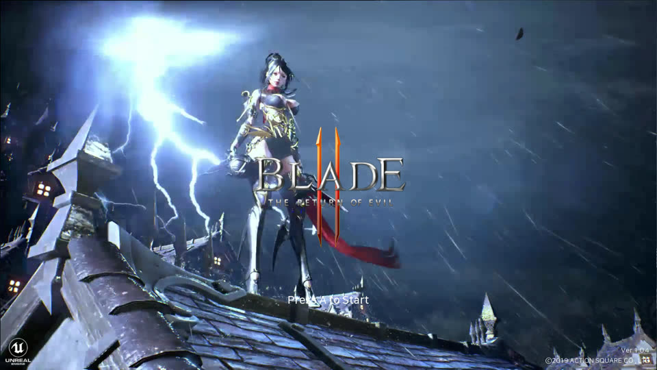
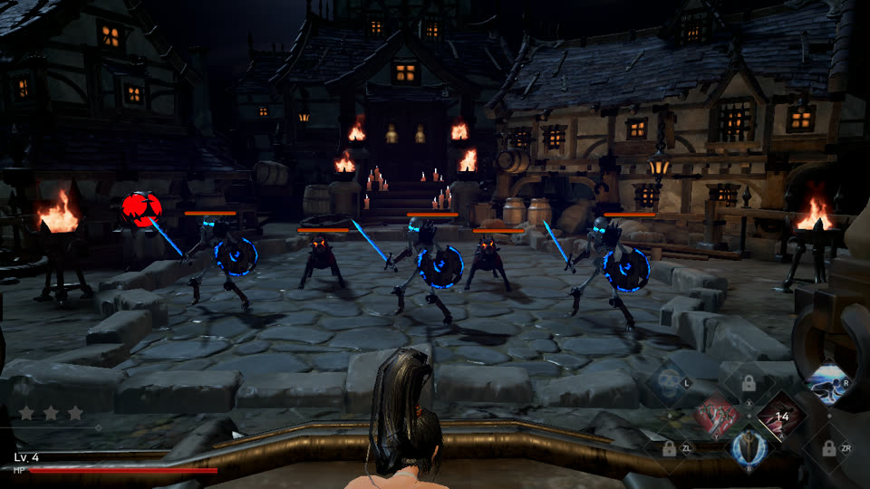
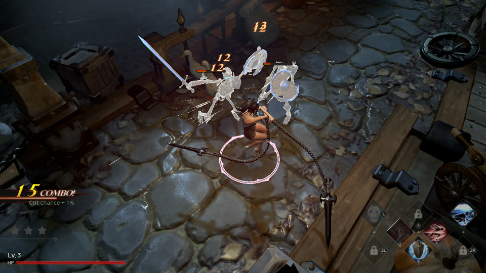
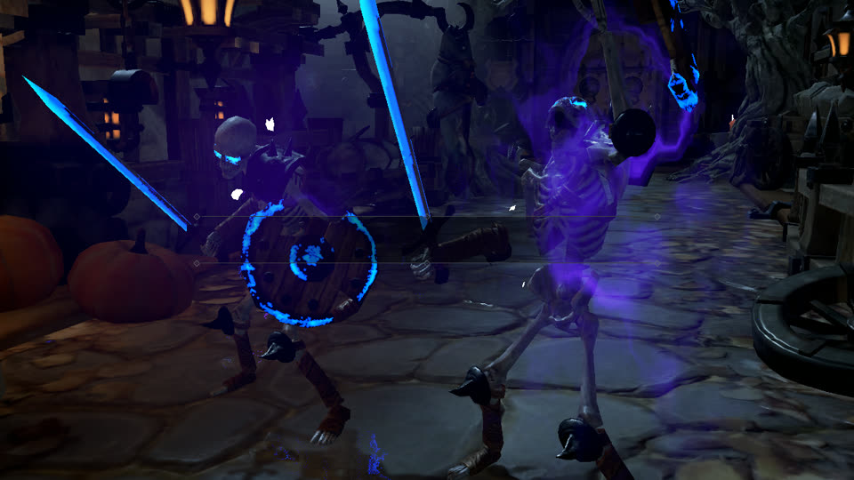
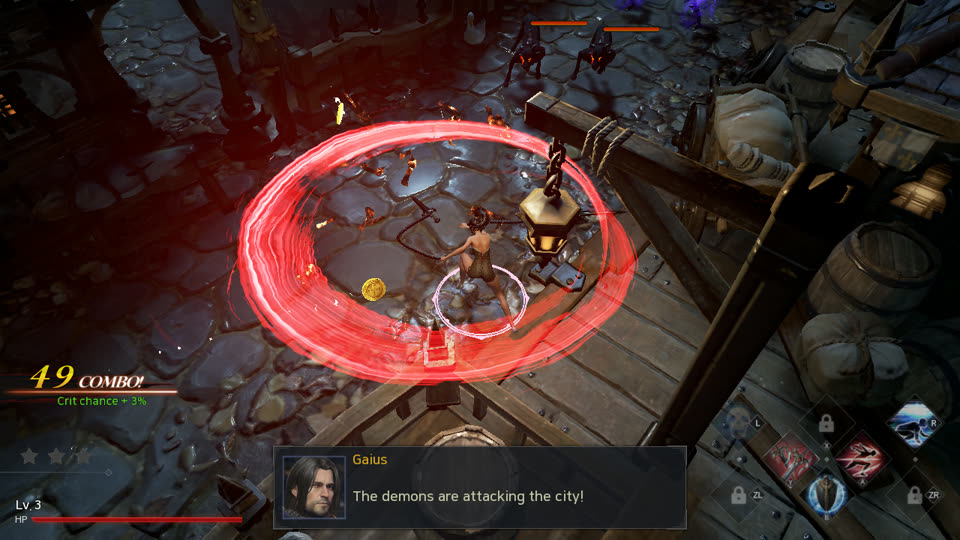
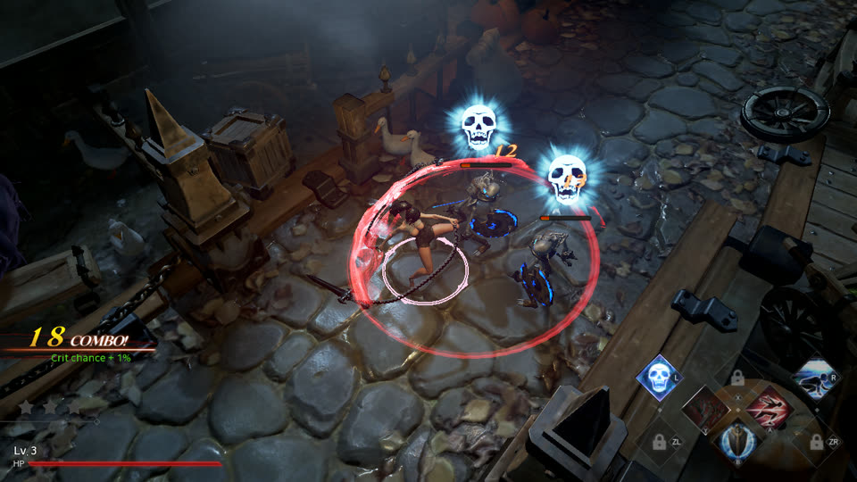

# Blade II Mobile

把 Switch 版《Blade II: The Return of Evil》（Unreal Engine 4.17）原生跑在 macOS 上的兼容层，iOS 壳同源。不是模拟器：游戏程序一字节不动地在 Apple Silicon 上执行，只把它对 Horizon 系统的依赖换成一个小宿主。方法来自 [d2r-mobile](https://github.com/jhaizhou-ops/d2r-mobile)，这里是把同一套方法用到第二款游戏、第二个引擎上的结果。

| | |
|---|---|
|  标题画面 |  过场：城镇广场 |
|  Act 1：骷髅兵、连击与伤害数字 |  蓝色光刃与紫色魔气 |
|  范围技能与对话框 UI |  发光骷髅头、点光源、烛光 |

Mac 宿主实机 1280×720 帧，缩到 960×540。截图只用于说明运行结果，版权归游戏权利人所有。

## 实现了什么

- **macOS**：可正常游玩。第 1–3 关与首个 Boss 已通关，60 fps，音频、mp4 过场、实体手柄、存档齐全；画面与真机一致（金属反射、光照通道、几何着色器分层渲染都已对上）。成品是一个带原版图标的 App / dmg。
- **着色器**：全部 10 220 个 NVN 着色器离线抽出并翻成 Metal，不依赖玩家"走到哪补到哪"；管线启动预热，局内不再现编。
- **iOS**：壳工程能为 iphoneos arm64 编出完整 App（含全量着色器库、实体手柄、音频会话、触摸虚拟手柄图层），尚未上真机。

## 技术要点

- **原生执行，离线改写**。AArch64 上只有 x18、TLS 寄存器、`svc`、系统计数器四类指令在苹果内核下不能原样跑，改写器把它们换成跳进补丁区的 `b`；补丁区按键页取线程槽，运行时零代码改写，iOS 可整段签名。UE4 / 新 clang 的三种跳转表写法（相对偏移表 `br x18`、`blr x18`、`ldr x18,=lit`）与超过 ±128 MB 射程的映像（补丁区放映像前）都已支持。每个改写点用 Unicorn 做随机状态等价试验。
- **宿主替代 Horizon**。SVC 换宿主函数（线程 = pthread，内存 = mmap），系统服务在 SDK 接口处按名字接管：文件系统、手柄、`nn::audio` 渲染器（按 voice 真混音：ADPCM 解码、重采样、混音矩阵 → CoreAudio）、时间、输入法、视频播放（AVFoundation）等。符号按真机 rtld 的全局插入语义解析。
- **图形在 NVN API 层接管**。523 个入口全部指向宿主，命令录制后用 Metal 回放；内存池是零拷贝 `MTLBuffer`，贴图从 Tegra 块线性布局反 swizzle（压缩格式块高封顶 8 GOB，与真机驱动一致）。UE4 用到的 37 个 d2r 未实现的入口（DrawElements、BindTexture、缓冲对象、FenceSync…）全部补齐。
- **着色器翻译链**：pak → Ryujinx 翻译器 → SPIR-V → spirv-cross → MSL → metallib，内容寻址缓存。翻译器离线不知道的东西由宿主运行时记成**事实表**回灌：贴图类型（缓冲 / 3D / 立方体数组）、整数顶点属性、整数颜色目标与整数贴图。Metal 没有几何着色器：写层号的几何着色器（LUT、半透明光照体、立方体阴影）被识别后融进顶点着色器变体；深度预通道要求逐位相同的位置，用 `-fpreserve-invariance`。
- **稳定性**：出图时等本帧 GPU 工作完成（一帧错画归零）、上传暂存块按栅栏复用（显存不再暴涨）、原子缓冲按地址绑定、GPU 拷贝目的地不再被脏页重传、模板视图按 HLSL 的分量习惯调换、管线预热清单。
- **工程方法**：无声脚本局（不出声、不点亮显示器、后台小窗）、按需抓帧 / 逐绘制 / 贴图原始数据、每帧账本与长帧归因，根因全部由计数支撑。

## 使用

```bash
tools/extract_game.sh "<你的 XCI>" prod.keys                       # 从你自己的游戏取 ExeFS / RomFS
E=~/blade2-work/data/switch/01009cc00e224000/v131072/Update/ExeFS; O=~/blade2-work/build/out
for m in sdk subsdk0 main; do python3 dm/tools/patch_nso.py $E/$m $O $m; done   # 改写三个模块
tools/shaders_iterate.sh                                            # 全量着色器 → Metal
DM_MAC_DMG=1 tools/mac_app_blade.sh $O                              # Blade II.app + dmg
```

细节与坑表：[docs/porting_playbook.md](docs/porting_playbook.md)（给下一款游戏的经验）、[docs/history.md](docs/history.md)（根因表与工程记录）、[docs/ios_pad.md](docs/ios_pad.md)（触摸手柄）。

## 版权与致谢 | Copyright and acknowledgements

**你必须拥有正版游戏。** 本仓库只包含兼容层的源码、工具和不含任何游戏内容的安装壳。我们不提供、不认可、也不对任何第三方分发游戏主程序、游戏资源、密钥、着色器转储 / 编译产物或改写产物的行为负责；请只配合你自己合法拥有的 Switch 版《Blade II: The Return of Evil》使用。仓库里与游戏相关的只有**事实表**（着色器键的哈希、绑定类型、改写器的指令偏移），不含任何游戏代码或资源。这是一个独立的非商业项目，与 Action Square、任天堂没有关联，也未获其认可或赞助；Blade II 是其权利人的商标，Nintendo Switch 是任天堂的商标。

**You must own the game.** This repository contains only the compatibility layer's source, tools and a content-free app shell. We do not provide, endorse, or take responsibility for any third-party distribution of the game program, game assets, keys, shader dumps / compiled shader libraries or rewrite outputs; use it only with your own legally owned Switch copy of *Blade II: The Return of Evil*. The only game-related files in the repository are **fact tables** (hashes of shader keys, binding types, instruction offsets for the rewriter); no game code or assets. This is an independent, non-commercial project, not affiliated with, endorsed by, or sponsored by Action Square or Nintendo; Blade II is a trademark of its owner and Nintendo Switch is a trademark of Nintendo.

致谢 | Acknowledgements
- **[d2r-mobile](https://github.com/jhaizhou-ops/d2r-mobile)**（MIT）：本项目的全部基础。`dm/` 是它的 `dm/` 目录加上 Blade 的改动，许可证原样保留在 `LICENSE.d2r-mobile`；方法论、宿主、NVN→Metal 翻译层、离线着色器链、iOS 壳都来自它，许多修正也直接吸收自它的后续提交。向作者致敬。| The whole foundation of this project: `dm/` is its `dm/` directory plus the Blade changes, with its license kept verbatim in `LICENSE.d2r-mobile`. The methodology, host, NVN→Metal translation layer, offline shader chain and iOS shell all come from it, and several fixes were taken directly from its later commits. Our thanks to the author.
- **Ryujinx**（Ryubing，MIT）：着色器翻译器原样携带于 `dm/third_party/ryujinx`。| Its shader translator is bundled unchanged in `dm/third_party/ryujinx`.
- **deko3d**（zlib）：块线性贴图布局算法的出处。| Source of the block-linear texture layout algorithm.
- **spirv-cross**（Apache-2.0）、**libdeflate**（MIT）、**NVIDIA FLIP**（BSD）：按各自许可证使用。| Used under their respective licenses.
