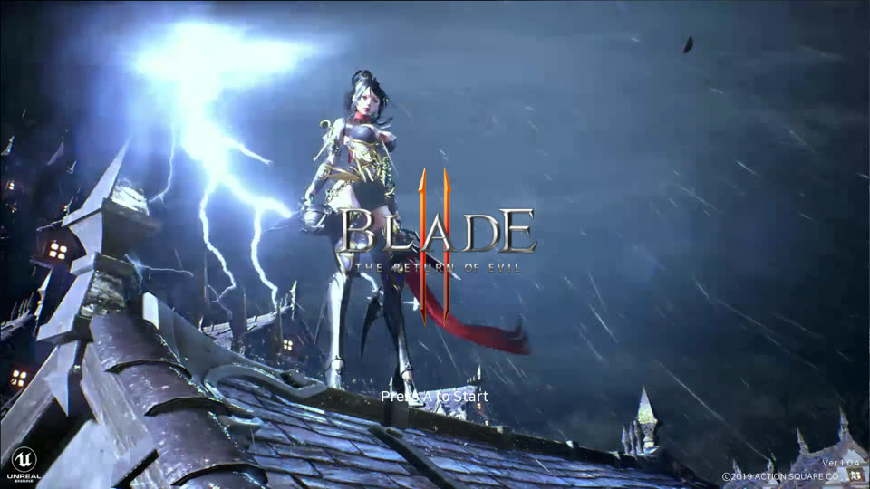
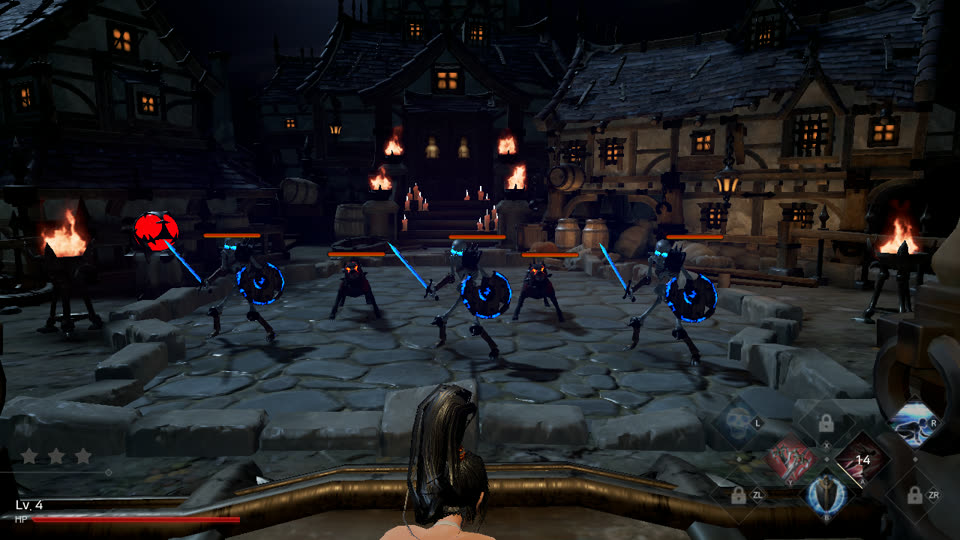
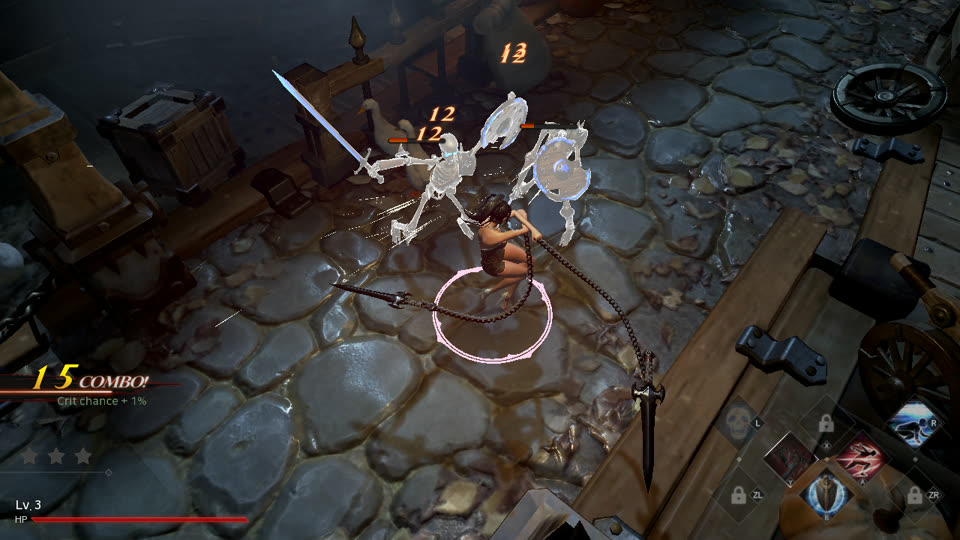
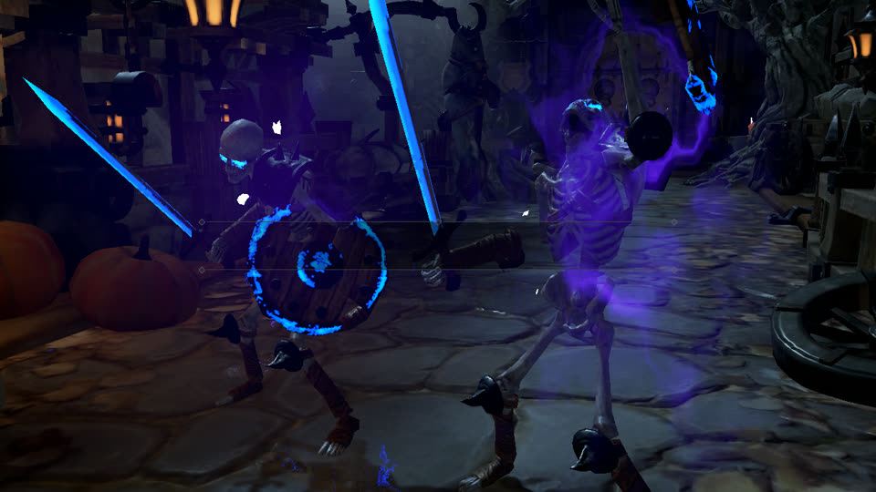
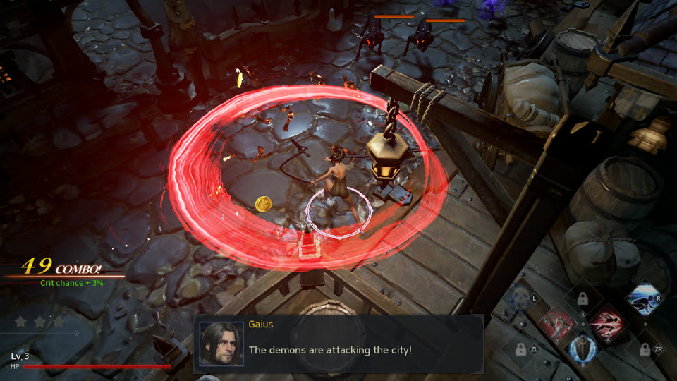
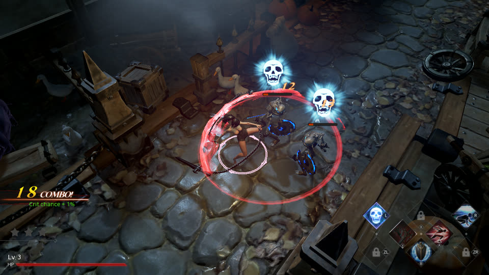

# Blade II: The Return of Evil on macOS（iOS 同源，Android 计划中）

Blade II 的移植记录：游戏分析、每个问题的数字与根因、版本与现状。构建与着色器链命令见 [development.md](development.md)，给下一款游戏的坑表见 [porting_playbook.md](porting_playbook.md)，开工前（2026-10-14）的调研与审计见 [survey/](survey/)，触摸手柄见 [ios_pad.md](ios_pad.md)。

游戏：title `01009cc00e224000`，更新 v131072，Unreal Engine 4.17，NintendoSDK 7.4。游戏内容（程序、资源、改写产物、着色器转储与 metallib、存档）一律不进仓库；下文 `W` = 工作区 `~/Documents/game_port/Blade/work`。

## 现状（2026-11-07）

| 平台 | 结果 | 证据 |
|---|---|---|
| Mac（Metal） | 可通关游玩：玩家通过第 1–3 关与首个 Boss；首 Boss 金属盔甲、装备界面角色光照、零星卡顿三项修复经玩家 10-22/23 验证；成品 `Blade II.app` / `.dmg`（游戏原图标） | 60 fps，帧时间 p50 16.6 ms，GPU 约 5 ms；管线预热 432 条 112 ms，整局 0 次同步建管线、0 红行 |
| iOS（Metal） | 壳为 iphoneos arm64 编出完整 App（全量着色器库、实体手柄、音频会话、触摸虚拟手柄图层），未上真机 | 卡在签名身份（`dm/ios/local.env` 的 Team ID） |
| Android（AYN Odin 3） | 未开始。决定不在本仓库补安卓后端，而是把 Blade 搬到 ff-mobile（nxnative 底座，已在 Odin 3 上跑 FF RESONANCE 与 Silksong）上建档案 | 见文末「安卓计划」 |

## 画面（Mac 宿主，玩家实机对局时宿主自动留下的 1280×720 帧，缩到 960×540）

| | |
|---|---|
|  标题画面（点光源、雨、闪电） |  过场：城镇广场，火光与蓝刃卫兵 |
|  Act 1：石板路、骷髅兵、连击与伤害数字 |  近景：蓝色光刃与紫色魔气（半透明光照体 + 几何着色器融合变体） |
|  范围技能的红色光环与对话框 UI |  发光骷髅头、点光源、烛光 |

截图只用于说明兼容层的运行结果，版权归游戏权利人所有（见 [README](../README.md) 的版权与致谢）。

---

## 游戏分析（本地 XCI）

| 项 | 值 |
|---|---|
| 游戏 | Blade II: The Return of Evil，title `01009cc00e224000`，更新 v131072 |
| 引擎 | **Unreal Engine 4.17** + PhysX 3.4（`++UE4+Release-4.17`、`D:\ProXTest\extra\Blade2toNS\...` 构建路径） |
| SDK | NintendoSDK 7.4（本体 6.5.2） |
| 模块 | `main` 48 MB（text 70 MB / rodata 37 MB / data 5 MB / bss 24 MB，解压后 131 MB）、`sdk` 13 MB、`subsdk0` 7 MB（任天堂 movie 库 + android 缓冲队列 + mkvparser） |
| 资源 | RomFS 4.1 GB：`BladeII/Content/Paks/*.pak`（两个 1.9 GB）+ 559 MB mp4 过场 |
| NVN | 取址 512 个函数，**静态调用 181 个**；其中 **37 个 D2R 从未调用**（`nvnCommandBufferDrawElements`、`BindTexture`、`BindVertexBuffer`、`SetViewport`、`nvnBuffer*`、`nvnQueueAcquireTexture`、`FenceSync`…），d2r 图形层没有实现 |
| 导入 | `main` 导入 608 个符号：d2r 宿主已接 153 个；其余 455 里 `nn::os` / libc++ / `nn::mem` / `nn::crypto` 等 SDK 用户态部分原样运行，真要新接的是 `nn::audio` 音频**渲染器**（39 个，D2R 只用 AudioOut）、联网一组、`nn::hid` Joy-Con / 六轴、`nn::time` 时区规则、`nn::swkbd` 配置、`movie` 媒体信息 6 个 |
| SVC | `sdk` 里 60 处；d2r 实现 35 号，其余（IPC / 共享内存 / 端口类）在服务被接管后不会到达 |

机器可读的清单：[`survey/main_imports_vs_d2r.tsv`](survey/main_imports_vs_d2r.tsv)（每个导入：命名空间、是否 d2r 已接、实现文件）。
分析脚本在 `tools/`：`nso_syms.py`（NSO 动态符号）、`import_coverage.py`、`main_imports_vs_d2r.py`、`br18_sites.py`（跳转表写法分类）、`dm/gfx/tools/nvn_slots.py`（已参数化，`NVN_LOADER=0x33e6400 NVN_TEXT_END=0x42bcef0`）。

---

## 版本

| 标签 | 日期 | 内容 |
|---|---|---|
| （未打标签，`main`） | 2026-10-23 | 玩家验证通过的三条修复：第一 Boss 金属盔甲全黑（原子缓冲绑定传了贴图号而非 GPU 地址 + 环境 BRDF 查找表被池内陈旧字节重传）、装备界面角色全黑（UE4 光照通道的整数颜色目标 / 整数贴图，见下表）、零星卡顿（画面触发器同步存 PNG，缺省改关）；立方体数组贴图不再多建 6 倍；无声测试脚本 `tools/diag/aba_run.sh`（`DM_AUDIO=0`、不点亮显示器）；管线预热缺省开（见下表「局内零星长帧」）。 |
| `v0.1.0` | 2026-10-18 | 第一个阶段性版本：Mac 宿主可通关游玩（已验证第 1–3 关，60 fps，音频、mp4 过场、实体手柄）；闪烁 / 一帧错画 / 显存暴涨三条线全部收口；`scripts/pak_shaders.py` 离线抽出全部 10 220 个着色器并推出贴图 / 属性事实，Mac 与 iOS 着色器库都是全量；iOS 壳能编完整 App，尚未上真机。下一步：iOS 真机运行、性能、触摸虚拟手柄浮层。 |

**2026-10-15 的结果（Mac 宿主，`scripts/run_mac.sh`，60 fps）**：标题 → 读档确认（世界地图底图）→ 章节地图 → 关卡选择（角色立绘、关卡预览图）→ 读取画面 → Act 1「Darkness in Luemos」：带贴图的石板地、木桶、锁链、尖塔，雾、烛光、点光源，主角（白发角斗士）与敌人（骷髅兵）的完整模型、鹅、受击特效、连击数字、受伤红闪，画面与真机一致；不操作时主角被打死出「Defeat」画面。截图在 `~/Documents/game_port/Blade/work/run/shot_*.png`。

着色器链已通：宿主转储（`DM_NVN_SHDUMP`）→ `dmsh_from_dump.py` 合成包 + 映射表 + 作答表 → `dmsh_build.py`（Ryujinx → spirv-cross → metal）→ 285 个着色器 281 个出库（4 个是立方体阴影的几何着色器，见下）。一轮迭代：`scripts/shaders_iterate.sh`。

## 根因表

画面之前「跑不出来」的根因（每条都有提交记录）：

| 问题 | 根因 | 处理 |
|---|---|---|
| 读取画面永远不结束 | 关卡加载关闭 UE4 视频播放器 → 对**从未打开**的 NVN 解码器调 Stop → 对未初始化的事件上内部锁，GameThread 死等 | 产品剪口：`0x3411998` 跳过 Stop |
| 进关卡崩在 `0x3a2de34` | 播放器关闭时遍历轨道「取消选轨」，流对象在宿主下恒空 | 产品剪口：`0x3a2aa70` 跳过轨道遍历 |
| 整帧稳定 200 ms | macOS **App Nap**：窗口不在前台时把进程定时器合并，`SleepThread(10 ms)` 要 200 ms 才醒 | `NSProcessInfo beginActivity`（LatencyCritical）退出 App Nap |
| 画面全蓝 / 全黑、光照像没有 | UE4 的 32³ 调色 LUT 与 64³ 半透明光照体用**几何着色器**写 `gl_Layer`；Metal 没有几何着色器，所有层都画进第 0 层，LUT 只有一层 → 色调映射后几乎全黑 | 离线把「直通 + 写层号」几何着色器翻成 GLSL 认出层号来源，融进配对顶点着色器（`<顶点键>+<几何键>_b` 变体，输出 `[[render_target_array_index]]`）；宿主按 `renderTargetArrayLength` 整体挂 3D 目标、管线带 `inputPrimitiveTopology`、去掉 `[[point_size]]` |
| 主角不显示 | 蒙皮顶点着色器从**缓冲贴图**读骨骼矩阵，翻译器离线不知道贴图类型，按 2D 声明 → Metal 读到 0 | 宿主运行时记每个着色器各槽实际绑定的贴图类型（`DM_NVN_TEXFACTS`，缓冲 / 3D / 立方体…），`dmsh_from_dump.py` 合进作答表 `shader_facts.tsv`；翻译器补上合并句柄表的槽号解码 |
| 火盆的火焰成方块、大贴图呈 2×2 错位条纹 | UE4 不走预排布参数，贴图按驱动**缺省块线性布局**写进池；宿主沿用 deko3d 的「高度×1.5」挑块高，对压缩格式挑到 16 GOB，真机驱动最多 8 GOB（Blade 实测 BC1/BC3 256²–1024² 全是 8，未压缩格式照旧到 16） | `nvn_tex.c`：压缩格式自动块高封顶 8；`DM_NVN_POOLDUMP` + `tools/diag/pooltex_th.py` 按块间连续性给每张贴图打分核对块高 |
| 开局教程卡「Move Hero」关不掉（按什么键都没用） | 卡片在 PlayerController 的 InputComponent 上 BindAction("LeftStickUp/Down/Left/Right", bExecuteWhenPaused)，这些动作映射到 Gamepad_LeftStick_Up 等「摇杆当按键」；真机 hid 按摇杆位置自动置 NpadButton::StickL*（bit 16–23），宿主只填轴值不填这些位 → 动作永不触发（轴映射的移动正常，所以之前没暴露） | `hle_hid.c` fill()：按半程阈值补 StickL*/StickR* 位。查法：UTF-32 字面量 → adrp+add 引用 → 绑定处 → `DM_PROBE` 确认绑定/关闭函数（`sampler_blade.c`：探针、采样器、`DM_MEMSCAN`） |
| 顶点 / 片元管线建不出（6652 处插值不匹配） | UE4 顶点 / 片元是分开的程序，翻译器要知道配对 | 宿主记配对（`DM_NVN_PAIRS`，含几何阶段 `2:`），翻译器 `SetNextStage` 并集（Ryujinx 的 `MergeFromtNextStage` 改成按位或） |

| 2D 贴图全黑（读取画面底图、关卡预览、UI 图片），3D 材质平的 | d2r 只把带「打包布局」（`SetPackagedTextureLayout`）的贴图从内存池解排布上传；UE4 按 NVN 默认块线性布局直接 memcpy 进池、不带打包布局，于是采样贴图都建成了空的私有 MTLTexture | `tex_pool_src`：池里有存储、不是显示 / 图像 / 可压缩渲染目标 / 线性渲染目标 / 缓冲贴图的，一律按池内容上传（Blade 实测采样贴图 flags = 0x20 / 0，渲染目标 0x8 / 0xc）；脏页跟踪与重传照旧（一局首传 322 张、重传 8978 次） |
| 地板成块缺失、带筛孔纹 | UE4 深度预通道 + 基础通道 GEQUAL 深度测试要求两个不同顶点着色器算出**逐位相同**的裁剪位置；Metal 默认 fast-math 下各着色器 fma 合并不同，MSL 的 `[[position, invariant]]` 不加编译选项不生效 | `xcrun metal -fpreserve-invariance`（Mac 与 iOS 两条编译口径都加） |
| 主角 / 敌人只剩武器，身体不显示 | 蒙皮顶点着色器的骨骼索引属性是 RGBA8UI 整数格式，翻译器离线不知道属性类型、按 `float4` 声明；Metal 把整数转成浮点值，着色器再 `as_type<int>` 得到垃圾骨骼索引——只绑 0 号骨骼的部件（武器）碰巧正常 | 宿主在建管线时记录每个顶点属性的分量类型（`DM_NVN_TEXFACTS` 文件里的 `attr:<槽>` 行），`dmsh_from_dump.py` 合进作答表的 `attr`，翻译器按 `uint4` 声明 |
| 装备界面的角色预览全黑，只剩金色自发光（2026-10-23 玩家验证已修） | UE4 **光照通道**：`CopyStencilToLightingChannels` 把模板位拷进 **R16Uint** 贴图，各盏灯的像素着色器读它决定照不照——翻译器离线不知道整数格式：片元输出按 `float4` 声明，Metal 拒建管线（`output of type float4 is not compatible with R16Uint`）；灯的着色器把它按 `texture2d<float>` 声明，Metal 读整数贴图得不到原始位。两头都断 → 预览场景一盏灯都照不到角色 | 宿主记两种新事实：`fout:<目标号> uint/sint`（建管线时颜色目标是整数格式）、`texfmt:<槽> uint/sint`（绑定的贴图是整数格式）；出包时前者让 Ryujinx 直接出 `uint4` 输出，后者把声明改成 `texture2d<uint>` 并把 read / sample / gather 的结果 `as_type<float4>` 按位转回（`dmsh_build.py` 的 `int_tex_rewrite`） |
| 局内零星 20–63 ms 的长帧（60 fps 下偶尔一顿） | 管线预热在 Mac 包里整个关着（Blade 没有 D2R 那样的种子清单），每局第一次遇到的渲染管线都在提交线程同步编；玩家一局 17 分钟里 8 次这样的长帧全是它。另外序列化管线键里着色器名只留 24 字节，几何着色器融合变体名（35 字节）被截断，清单里的这些管线预热时打不开库 | 预热改成「种子清单 / 本机记录有哪个用哪个」；打包脚本把工作区 `pso_manifest.tsv`（本机游玩记录汇总）带进包；键名字段放宽到 40 字节（旧格式行按长度跳过）。验证：预热 432 条管线 112 ms，整局 0 次同步建管线、0 红行 |
| 点光源立方体阴影不画 | 4 个几何着色器把三角形发到 6 个面（`EmitVertex` 18 次，层号 0–5 常量，每面乘 `gp_c3` 第 6+4f 行起的矩阵、`_m0[f].x` 为面开关） | 离线认出这一族（`dmsh_build.py gs_cube`），顶点变体按 `instance_id % 6` 选面与矩阵、输出层号与面号常量；几何阶段 uniform 以 `stage=2` 绑定挂进顶点参数块；宿主把实例数与基实例 ×6（反射 `gs_faces`）。坑：UE4 阴影顶点只写世界坐标 xyz，真机上未写的插值 w 缺省 1 而翻译出的 MSL 清零 → 融合时补 1，否则平移行丢失 |
| 闪烁 / 抖动（Mac 窗口，2026-10-16 收口） | 三个独立原因叠加，分别有数据：① 串流 / 电视把显示器报成 30 Hz，60 帧游戏每帧只能显示半拍 → 整局 33 ms 一帧；② 出图走显示回调路径时，系统有其它负载（虚拟机、构建、浏览器）回调整秒不来，宿主的兜底（丢排队帧、重出旧帧、空 drawable）就是黑闪；③ 没见过的着色器被跳过绘制，物体整个变黑，看起来像闪。 | ① 出图帧率按窗口所在屏幕的刷新率取整除档（30 Hz 屏 → 30，120 Hz → 60）；② Mac 缺省改为出图线程自取 drawable（`DM_PRESENT_LINK=0`），垂直同步交给 CAMetalLayer；③ App 缺省把没见过的着色器转储到应用支持目录，`scripts/shaders_iterate.sh` 补进映射表。三项都做完后：60 Hz 与 120 Hz 的 HDMI 显示器上通关第一关均无闪烁（玩家实测）。120 Hz 下理论上仍有「1 拍 / 3 拍交替」的微抖（递交未锁到刷新格点），实测不可察觉，留作后续。 |
| 一帧错画（2026-10-17 收口）：黑屏只剩特效光影、火焰闪、地上白块 / 白线 / 红蒙版，Boss 战最密，同一位置时有时无，60 / 120 Hz 都有 | 画面触发器 + 帧账 + 通道环 + 提交账三路数据：① 错帧的渲染通道序列与相邻帧完全一致（没少画），遮挡查询结果与绘制数也不变 → GPU 读到了错数据，不是 CPU 侧剔除；② 每个错帧之后 1–2 帧，游戏都在 `nvnSyncWait` 里多等 30–54 ms（正常 12 ms）→ 错帧的 GPU 执行被推迟了；③ GPU 从未落后超过 4 次提交，完成回调无乱序，宿主的竞技场 / 命令分配器只在完成后复用；④ 用 `DM_NVN_GPU_SPIN` 复现器（人为拖慢 GPU，110 s 脚本战斗）做对照：不等 3–9 个整帧黑 / 9–19 次大块错画；每帧出图时等本帧 GPU 做完（`SERIAL=1`）→ 1 / 1（剩的在关卡读取过渡）；全串行 `SERIAL=5` → 0 / 0；只在提交间等 `SERIAL=8` → 2 / 2；取图时多等一帧 `ACQ_DEPTH=2` → 18 / 34（更差）；竞技场多等 2 次 `ARENA_SLACK=2` → 2 / 4。结论：下一帧的 CPU 写与本帧的 GPU 读跨帧重叠时出错；**具体被覆盖的是哪块内存尚未定位** | Mac App 缺省 `DM_NVN_SERIAL=1`：每帧出图时等本帧游戏提交的 GPU 工作完成（不等出图命令缓冲，不卡垂直同步）。代价：帧时间 p50 16.66 / p95 17.98 ms，最大帧从 48 ms 降到 19.7 ms（反而更稳）。`DM_NVN_SERIAL=0` 可关掉对照。后续定位手段已备好：帧账每帧记 GPU 开工 / 收工时刻、绘制数、遮挡查询、三类等待；触发器不限次数。 |
| 显存暴涨（2026-10-17 收口）：窗口失焦被盖住后显存每秒涨 300 MB，7 分钟到 24 GB 被内存看门狗杀掉（玩家切到别的窗口就会中招） | 新加的「分配账」（给 Metal 设备的 newBuffer / newTexture 换上按调用点计数的版本，随内存读数行打印）直接点名：`pkg_upload` 里的上传暂存块每批新建 32 MB、冲刷后延迟退役，而 Blade 有一张 128x128 贴图被游戏每帧重写 → 每帧新建 + 退役 32 MB（实测 1.5 次 / 帧，每秒 2.9 GB 的分配周转）；出图一卡延迟释放落不了地，显存就只涨不落。驻留集对象数不变，所以之前的驻留普查看不出来 | 暂存块按栅栏复用：上传命令缓冲在 GPU 上做完后把标准块放回复用池（最多 4 块），下批直接取。验证：每 300 帧新建从 14 400 MB 降到 18–33 MB，「累计新建 2 块（复用 287 次）」，显存平稳。 |
| 着色器要靠玩家「走到哪补到哪」（2026-10-18 收口） | 宿主只能在 `nvnProgramSetShaders` 时见到着色器，所以映射表只覆盖玩过的场景（通关 1–3 关后 414 个），新区域必有一次黑物体 + 自录 + 重译。pak 里没有 `.ushaderbytecode`，但材质 uasset 与 `Engine/GlobalShaderCache-GLSL_SWITCH.bin` 里内联着 zlib 压缩的 glslc 输出：`LSLGSP` 头 → 代码区（0x30 NVN 头 + SPH + 指令）→ 4 字节 → 0x880 控制段 → NV_gpu_program5 汇编文本 | `scripts/pak_shaders.py`：解 pak（v4，zlib 分块）→ 每个资源里的 zlib 流 → 按控制段魔数切出 blob → 转成与 `DM_NVN_SHDUMP` 同格式的 `<键>.ctl/.code`；并从汇编推出翻译要的事实：`LDC.U64 Dn, buf14[off]` + `TEX … handle(Dn), 2D/3D/CUBE/BUFFER…` → 贴图槽 = off/8；顶点属性被 `.S/.U` 指令读取 → 整型。核对：414 个运行时转储逐字节相同，572 条贴图事实 / 626 条属性事实 0 条不符。全游戏 10 220 个着色器（顶点 2785 / 像素 7177 / 计算 250）一次翻完 13.7 分钟，10 205 个出库；没出库的 8 个几何着色器按设计不出库（融进顶点），13 个计算着色器 spirv-cross 抛 nullptr（带本地数组 + 共享内存，运行时尚未出现过，待查）。App 从 154 MB 变 332 MB。运行时自录只剩几何着色器配对还需要。 |

2026-10-15 午后：**有声音了**——`hle_blade.c` 的音频渲染器按 SDK 接口真混音（游戏用 32 个 44.1 kHz 单声道 DSP-ADPCM 声音槽 → 32 kHz 渲染器 → CoreAudio，`DM_AUDIO=1`，`DM_AUDIO_GAIN` 调响度，`DM_AUDIO_OUT_DUMP` 存混音）；d2r 的暗黑专属固定地址缺省在通用宿主下全部失效（`DM_GENERIC_HOST`）；TBDR 优化开启验证通过（画面一致、GPU 时间持平，Mac 默认仍关）；200 秒脚本游玩（移动 / 攻击）无崩溃。

**此前（同日白天）的结果**：引擎循环先跑起来（900 帧 / 60 秒，画面空）时修掉的通用问题：

| 问题 | 根因 | 处理 |
|---|---|---|
| 改写器拒绝 `br x18` / `blr x18` / `ldr x18,=lit` | UE4 / 新 clang 的代码形态 | 三种新改写块（见 [development.md](development.md)「为 Blade II 改了什么」） |
| `b` 跳不到补丁区 | 映像 131 MB > ±128 MB | 两遍发射，补丁区放映像前 |
| `StandardAllocator::Initialize` 中止 | UE4 要 16 GB 虚拟地址区，d2r 的 alias 区只有 512 MB | 当时用 `DM_ALIAS_GB` 放大；后来发现下一行的 `DM_SYSRES_MB=0` 让游戏根本不走这条路（见上文「还没做」第 4 条 iOS 壳），alias 又回到 512 MB |
| 按真机走普通堆而不是虚拟内存 | Blade 的 npdm `SystemResourceSize = 0` | `DM_SYSRES_MB=0`（d2r 写死 32 MB；通用宿主现在缺省 0） |
| 构造函数里 `FMemory::Free` 空指针崩 | sdk 内 libc++ 的 `basic_string` 走 sdk 自己的 `operator new`，释放却走 UE4 的 Binned 分配器；真机 rtld 是**全局插入**（main 的定义优先） | 装载器改成按装载顺序全局解析符号 |
| `StandardAllocator::Allocate` 接管崩 | d2r 写死了 `sdk+0x2f9974` | 改按符号名取 |
| 目录枚举递归到栈溢出 | 我写的 `GetDirectoryEntryCount` 用 telldir/seekdir 搅乱了目录流 | 另开目录流计数 |
| 图形层第一批调用报未实现 | UE4 的 NVN RHI 用缓冲对象 / 组合贴图句柄 / DrawElements 等 37 个入口 | 全部补上，落在 d2r 的录制 / 回放框架里 |
| `GetSparseTileLayout` 后 memset 负长度崩 | 仓内 `nvn.h` 把该结构留成 1 字节占位 | 按真实布局 0x1c 字节清零 |
| 开场视频 Tick 空指针 | movie 库在宿主下只空播，RHI 流对象从未建立 | 产品剪口：`0x3a29e40 → ret` |

---

## 还没做 / 已知问题

0. **偶发 GPU hang**（进关卡时出现过一次 `kIOGPUCommandBufferCallbackErrorHang`，后续帧恢复）；`MemoryPoolMapVirtual` 现已实现映射表但本游戏没用到。
1. **点光源阴影的画面验证**：Act 1 开头没有带阴影的点光源，只在标题场景（角色近景、无地面）用到；立方体图 6 个面已有几何、比较采样器正确，等遇到有接收面的场景再对比。
2. **音频**：已出声（Mac `DM_AUDIO=1`）。渲染器事件「写端失效」的根因是游戏 Detach 读端后 Destroy 临时 SystemEvent，宿主现在按内核事件对象触发而不按句柄。还没做：I3dl2 混响（只出干声）、ParseAdpcmHeader 之外的 SDK 纯计算都没动；音量偏大（开场曲与局内多 voice 叠加有削波），要对着真机录音核对增益口径。
3. **TBDR 优化**（写回前瞻 / 读入可省 / 延迟通道）现在全关（`DM_NVN_TBDR=0`），是 D2R 调过的，Blade 上要重新验证后再开；`MemoryPoolMapVirtual` / `Downsample` 仍只报红。
4. **iOS 壳**（`dm/ios/blade`，2026-10-15 晚）：已能为 iphoneos arm64 编出完整的 App（Debug / Release，`CODE_SIGNING_ALLOWED=NO`，152 MB），没有真机 / 签名身份，没在手机上跑过。做了的：
   - **补丁区在前的布局**：`gen_embed.py` 按 `PATCH_OFF < 0` 把文件切成 `__TEXT,__dm<名>x1`（补丁区，文件 [0, −PATCH_OFF)）/ `__TEXT,__dm<名>x0`（原 text）/ `__DM<名>W`（ro 余部 + data + bss + 键页）；`loader.c` iOS 分支按 x1 长度 == −PATCH_OFF 认出，保留「补丁区 + 映像」一块地址再 `vm_remap` 回原相对位置。Mac 上可用 `make -f Makefile.blade embed`（`-DDM_EMBED_IMAGE=1`）走同一条内嵌装载路径验证（映像编进 Mac 可执行文件，游戏照常进局）。
   - **16 GB 虚拟地址区——不需要**：UE4 的 `AllocateAddressRegion(16 GB)`（`main+0x12ccb94` 的缺省常数，`main+0x6c28c18` 可配置）只在 `nn::os::IsVirtualAddressMemoryEnabled()` 为真时走（`main+0x12cca88` 的分支），而 Blade 的 npdm `SystemResourceSize = 0` 让它为假，走 `SetMemoryHeapSize(3650 MB)` 的普通堆路线。通用宿主的 `DM_SYSRES_MB` 缺省改成 0（`hle_svc.c`），`run_mac.sh` 不再设 `DM_ALIAS_GB=18`：alias 512 MB、整块预留 5 GB，Mac 实测进局无红；5 GB 在 iOS 不签「扩展虚拟寻址」时也放得下（上限 6 GB）。工程仍签 `increased-memory-limit`（3650 MB 堆的常驻）与 `extended-virtual-addressing`（地址余量；免费账号删掉那一行即可），不做剪口。
   - **工程**：`dm/ios/blade/project.yml`（XcodeGen）+ `run.sh`；宿主源文件由 `gen_build.py` 从 `Makefile.blade` 展开（`-DDM_GENERIC_HOST=1` 等 `-D` 原样进 xcconfig），外壳只有 `Sources/main.m`（日志、找 RomFS、环境变量、提前装载、场景生命周期）与 `Sources/front_blade.m`（Metal 视图 + **通用虚拟手柄**：左摇杆浮动、右摇杆、A/B/X/Y/L/R/ZL/ZR/+/−/L3/R3/十字键，经 `dm_input_set` 进 `hle_hid.c`；接上实体手柄时自动隐藏，全部断开再显示）。`ENABLE_DEBUG_DYLIB=NO`（Xcode 的调试 dylib 会把内嵌段与 `_mh_execute_header` 搬出主可执行文件）。
   - **iphoneos 着色器库**：`dmsh_build.py` 的 `IOSOUT` 路径现在也出融合变体 `<顶点键>+<几何键>_b`（含 `-fpreserve-invariance`）并进内容缓存；301 个库 + 6 个融合变体 + 40 个采样变体。
   - **实体手柄**（`dm/host/gamepad_generic.m`，Mac 与 iOS 共用，GameController.framework，热插拔）：面键按位置排——下→B、右→A、左→Y、上→X（游戏画的是 Switch 键帽提示；`DM_PAD_FACE=letter` 改按字母），L/R、ZL/ZR、L3/R3、菜单→＋、选项→−、十字键；摇杆径向死区 12%（`DM_PAD_DEADZONE`）。Mac 上与键盘并存（`front_mac.m` 原有的 `dm_gamepad_start` 调用，不再是 `blade_stubs.c` 的空实现）。没有实体手柄实测，只验证了启动枚举（日志「手柄：GameController 启动，系统当前列出 N 个」）。
   - **iOS 音频会话**（`dm/host/audio_session.m`，`hle_blade.c` 建 RemoteIO 前调）：Playback 类别、不与别的 App 混音；打断开始 / 结束与进后台 / 回前台合成一个开关停 / 起渲染器的声卡单元（`dm_audren_suspend`，停着时节拍线程照实时静音消耗）；线路变化只记日志。音频渲染器缺省改成与 `hle_audio.c` 同口径：iOS 真出声、Mac 静音（`DM_AUDIO` 仍可覆盖）。没在真机上验证。
   - **触摸虚拟手柄图层**（2026-10-18 设计稿，见 [ios_pad.md](ios_pad.md) 与效果图）：几何与绘制在 `Sources/pad_layout.h`（纯 C），Mac 上 `tools/ios/pad_mockup.m` 用同一份代码把图层画在游戏截图上出效果图，不用真机就能调布局。布局沿用原版：战斗 HUD 右下本来就是一块 7 格菱形（上排 L X R、中排 Y A、下排 ZL B ZR），右手 8 键就半透明地叠在这些格子上（位置是 16:9 画面的比例坐标，按下填白），玩家按的就是屏幕上看到的那个格子；左半屏浮动摇杆 + 十字键图标，顶边 L3 R3 / − ＋；松手 2.5 s 淡出，按键有震感，实体手柄接上自动隐藏。
   - 还没做：真机上跑（发热 / 内存上限读数、图层重绘开销）、触摸屏（游戏只认手柄，没接 `dm_touch_set`）。
5. **验证工具**：`structck.py` / `equiv.py` 认识 `JA` 行、负偏移补丁区与新改写块。
6. **局内显存缓慢增长**：玩家 10-23 一局 17 分钟里 GPU 内存 0.9 → 2.6 GB（驻留池 421 → 592 个），未定位；失焦暴涨那条（每秒 300 MB）已修，这条是另一个慢速来源。iOS 内存上限更紧，上真机前要查。

---

## 安卓计划（2026-10-26 决定）

**为什么不在本仓库做**：这里只有 Metal 回放层和 Mac / iOS 壳，没有 Java / JNI 壳、Vulkan 引擎、改写器的 bionic TLS 槽位目标。上游 d2r-mobile v2.0（b811b90）加了这三块（`dm/android`、`dm/gfx/vulkan`、`DM_TARGET=android`、`dmsh_vk.py`），但与本仓库 18 个文件冲突（`hle_nvn.c` +475、`nvn_mtl.m` +485、`patch_nso.py` +149 …），再加 UE4 用到的 NVN 入口在那套 Vulkan 引擎里的缺口，估两周。ff-mobile 这三块都有且已在 Odin 3 验证（Adreno 830：无 `VK_EXT_external_memory_host`、纹素缓冲对齐 64、整数纹理经 `vk_tex_ct.tsv` 重定型、`VkPipelineCache`、几何着色器与 `shaderOutputLayer` 可用）。

**能原样带过去的**：改写器的三种跳转表写法与负偏移补丁区（nxnative 也有）；UE4 用到的服务层（fs、oe、movie、音频渲染器）；事实表——贴图类型、整数顶点属性、整数颜色目标、整数贴图，Vulkan 侧的 `vk_tex_ct.tsv` 就是这些表换格式；全量着色器集合与 `pso_manifest.tsv`（键是着色器键，与后端无关，只有编译产物要重出 SPIR-V 包）；本文根因表与 playbook。

**步骤**（估 3–5 天，只有最后一步要 Odin 3 插 USB）：
1. ff-mobile 开分支 `blade`，单独克隆到 `W/nx`，不碰 FF 的 `ff` 分支与工作区。
2. 游戏档案 `dm/games/01009cc00e224000/`：identity、build 行、模块、3 个产品剪口（movie Stop / 轨道遍历 / Tick）、启动参数。
3. `scripts/pak_shaders.py` 的输出转成 nxnative 的着色器集与事实格式（含 `vk_tex_ct.tsv`）。
4. 先在 Mac 上用 nxnative 底座跑通 Blade（验证档案，不用设备）。
5. 走 FF 已验证的安卓五步：`DM_TARGET=android patch_nso.py` → `dmsh_vk.py` → `vkpack.py` → `make_pack.py` → gradle 出 APK。
6. Odin 3 上机：`dm/android/tools/device_test.sh` + `log_summary.py`，先给通过 / 失败。

本仓库保持 Mac 成品不动；安卓版出来后再决定是否迁仓库。
