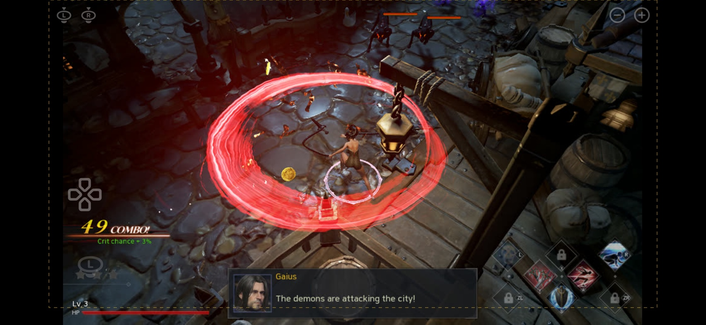
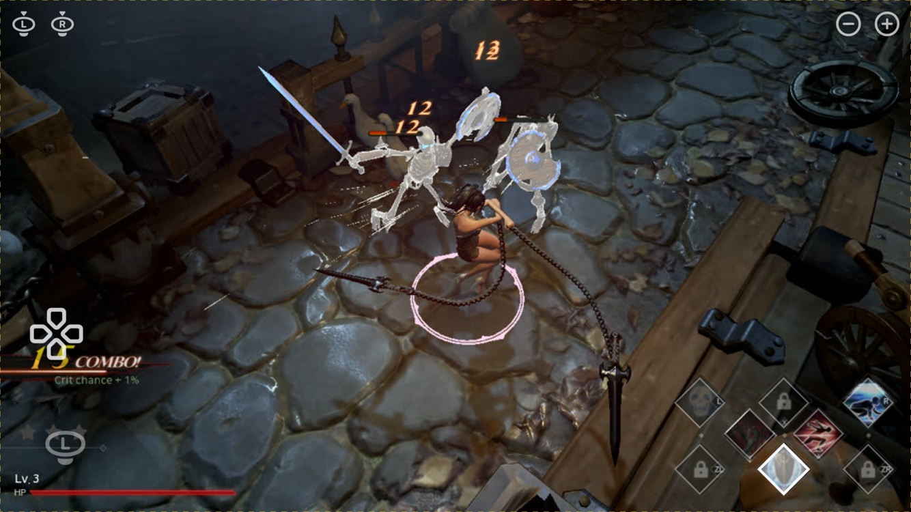

# iOS 触摸虚拟手柄图层（设计，2026-10-18，第 4 稿：右手键直接叠在游戏 HUD 的格子上）

代码：`dm/ios/blade/Sources/pad_layout.h`（几何 + 绘制，纯 C / CoreGraphics；右手 8 键是叠在游戏 HUD 格子上的半透明菱形框，左侧 / 顶边的小键用系统 SF Symbols 手柄图标 `dpad` / `l.joystick` / `plus.circle`…，由宿主按名提供位图、这里染白摆放）、`dm/ios/blade/Sources/front_blade.m`（触点归类、淡出、震感）、`tools/pad_mockup.m`（Mac 上出效果图，用的是同一份几何与绘制代码）。

## 效果图（Mac 渲染，真机画的就是这份）

| | |
|---|---|
|  iPhone 15 Pro 横屏 852×393 点，安全区 左右 59 / 下 21（黄虚线）；左摇杆推右上、Y 与 R 按下 |  同机型，松手 2.5 s 后的空闲态（整层透明度 0.45） |
|  iPhone SE 级 667×375 点、无安全区、16:9 铺满；B 按下 | |

右下角放大看（15 Pro，6x 渲染）：菱形框与 HUD 的 7 格一一对位，Y、R 按下时填白。

## 依据

- 这是原生手柄游戏：战斗 HUD 右下本来就把 8 个键摆成一块 7 格菱形——上排 L / X / R，中排 Y / A，下排 ZL / B / ZR，格里是技能图和键名。作者真机确认的用法：**Y 普攻（最常用）、B 格挡、A 技能、L 终结技、R 闪避**，ZL / ZR 基本不用；十字键对应摇杆方向。
- 所以 iOS 上不另造手游式布局（第 3 稿的"普攻大键 + 扇形"被否）：右手 8 键半透明地叠在这些格子上，玩家按的就是屏幕上看到的那个格子，位置随 16:9 画面缩放。
- 游戏输入映射（pak 里的 `BladeII/Config/DefaultInput.ini`）：全部手柄键都映射成动作；左摇杆是移动轴（死区 0.25），右摇杆只在背包里转角色（`InvenRotateMove`）。
- 出图是 16:9 居中留黑边（`nvn_mtl.m` 出图视口），iPhone 19.5:9 两侧各有约 0.09 H 的黑柱。
- 前三稿：第 1 稿 0.075 H 粗白圈 + 字母（太大太丑）；第 2 稿缩小 + Switch 图标但仍是菱形、键贴键（没按实际用法、大小间隙不对）；第 3 稿手游扇形（方向错：应沿用原版 HUD 的排法）。

## 布局

| 控件 | 位置 | 大小 / 命中 |
|---|---|---|
| **右手 8 键 L X R / Y A / ZL B ZR** | 16:9 画面矩形的比例坐标（从 960×540 截图量得）：u = 0.768 / 0.860 / 0.953（L、X、R 列），Y、A 在 X 列 ±0.037；v = 0.787 / 0.847 / 0.917（三行） | 菱形框对角半宽 0.027 画面宽（15 Pro 19 点、SE 18 点）；命中半径 0.05 画面宽（35 点），相邻命中圈重叠、取最近者 → 整块按最近格子划分 |
| − ＋ | 右上角，`minus.circle` / `plus.circle` | 0.5r / 0.75r |
| L3 R3 | 左上角（极少用，最小最淡） | 0.5r / 0.75r |
| 十字键 | 左侧中部、摇杆区之上（矮屏自动让开 L3 R3）：一个 `dpad` 图标 + 深色圆底，按下画 `dpad.<向>.filled`；命中按四向分 | 0.5r / 0.625r |
| 左摇杆 | 左 45% 屏空处浮动，落点为中心，满偏 1.8r；空闲时左下 (2.2r, 2.2r) 只画一个淡的 `l.joystick` 图标 | 8% 死区（游戏自己还有 0.25） |
| 右摇杆 | 右 55% 屏空处（背包转角色），不画空闲圈 | 同上 |

左侧 / 顶边尺寸基准 `r = H × 0.058`，夹在 17–32 点；`DM_PAD_SCALE` 只缩放这些，右手 8 键由 HUD 定位不动。

## 行为

- 每根手指按落点归类：命中键圆 → 该键（重叠处取最近）；否则按 x 分左右摇杆。手指在格子之间滑动即换键，换键有震感。
- 右手 8 键空闲时只画 1.2 点细的白框（透明度 0.35），按下填白 0.45 + 2 点亮框；不画图标，HUD 里本来就有。菜单里 HUD 不显示时淡框仍指位。
- 松手 2.5 s 后整层淡到 `DM_PAD_ALPHA`（缺省 0.45），再碰立即回 1。
- 实体手柄接上时整层隐藏、触点只当摇杆；全部断开再显示。
- 环境变量：`DM_PAD_OVERLAY=0` 不画；`DM_PAD_SCALE` 0.8–1.4 整体缩放；`DM_PAD_ALPHA` 空闲透明度；`DM_PAD_HAPTIC=0` 关震感。

## 改布局的流程

改 `pad_layout.h`（右手 8 键的比例坐标在 `hud_u` / `hud_v`，左侧图标名在 `k_glyph`）→ `clang -fobjc-arc -framework AppKit -framework CoreText -I dm/host -I dm/ios/blade/Sources tools/pad_mockup.m -o /tmp/pad_mockup` → `/tmp/pad_mockup docs/screenshots/03_skeletons.jpg out.png 852 393 0 59 21 59 3 Y,R 0.7,0.5 1` 看图（工具还会打印每个键的中心 / 半径 / 命中半径 / 与最近邻的间隙）→ 真机 `dm/ios/blade/run.sh build && install && launch`。

## 真机上要验的

1. 启动日志 `虚拟手柄：窗口 … 安全区 …` 一行的数值与机型相符（横屏左右 59、下 21）。
2. 菱形框与真机 HUD 的格子对位（截图量的比例 ±0.002）；Y→B、Y→R 的连按不误触；格子只有 38 点宽但命中 70 点，看是否够准；摇杆落点区与十字键不打架；图标在真机上的清晰度（3x 位图，渲染字号 64）。
3. 空闲淡出不遮 HUD；背包里右半屏滑动能转角色。
4. 整层 `drawRect` 的重绘开销（每次触点变化重画一次 Core Graphics）对帧时间的影响——如可见，改成 CALayer 分层只动变化的键。
